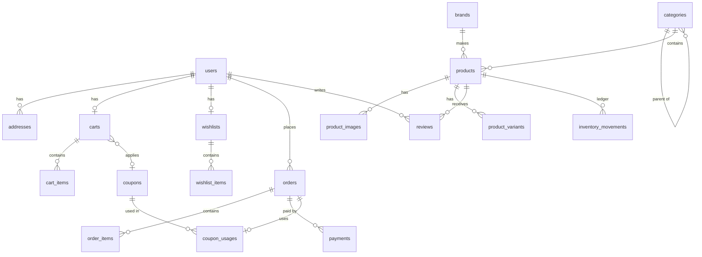

# Database

MySQL 8 / MariaDB 10.4+, `utf8mb4`. Migrations live in `backend/database/migrations`.

## Conventions

- **Money** columns are `UNSIGNED BIGINT` **cents** (`price`, `grand_total`, …). Coupon
  `value` is whole percent for percentage coupons and cents for fixed coupons.
- **Stock** columns are `UNSIGNED INT`, so the database itself rejects negative stock as a
  final safeguard (the application refuses it first).
- Status columns store enum string values (`App\Enums\*`).
- Soft deletes on `users`, `products`, `categories`, `brands`, `coupons` keep order history
  and reports intact.

## Entity overview

Spatie tables: `roles`, `permissions`, `model_has_roles`, `model_has_permissions`,
`role_has_permissions`. Framework tables: `sessions`, `password_reset_tokens`, `cache`,
`jobs`, `failed_jobs`, `personal_access_tokens`.

## Tables

| Table | Notes |
|---|---|
| `users` | `is_active` (deactivation), `last_login_at`, soft deletes. Email unique |
| `addresses` | Owned by a user; `is_default_shipping` / `is_default_billing` (at most one of each, maintained by `AddressService`) |
| `categories` | Self-referencing `parent_id` (restrict on delete), unique `slug`, `is_active`, `is_featured`, `sort_order`, `image_path` |
| `brands` | Unique `name` and `slug`, `logo_path`, `is_active` |
| `products` | Unique `slug` and `sku`; `price`, `compare_at_price`; `stock_quantity`, `low_stock_threshold`; `status`; dimensions/weight; SEO fields. Denormalised `rating_average`, `rating_count`, `sales_count` for efficient sorting |
| `product_images` | `path` on the public disk (no binary data in MySQL), `sort_order`, `is_primary` |
| `product_variants` | Unique `sku`, JSON `options`, optional `price` override, own `stock_quantity`, `is_active` |
| `carts` | Either `user_id` (unique) or guest `token` (unique UUID); optional `coupon_id` |
| `cart_items` | `product_id`, optional `product_variant_id`, `quantity`. Generated column `variant_key = IFNULL(product_variant_id, 0)` with a unique index `(cart_id, product_id, variant_key)` — prevents duplicate lines even for items without a variant |
| `wishlists` / `wishlist_items` | Unique `(wishlist_id, product_id)` prevents duplicates |
| `coupons` | Unique `code`, type/value, min order, max discount, start/expiry, global and per-customer limits, `is_active` |
| `orders` | Unique `order_number`; unique `(user_id, idempotency_key)`; separate `status` and `payment_status`; money totals; JSON **snapshots** of shipping/billing addresses; tracking, notes, lifecycle timestamps |
| `order_items` | **Snapshot** of product name, variant name, SKU and unit price; product/variant FKs are nullable (`nullOnDelete`) |
| `payments` | One row per attempt: gateway, method, status, amount, unique `idempotency_key`, unique `transaction_reference`, non-sensitive `meta` (card brand/last4 only) |
| `coupon_usages` | One per order (unique `order_id`); used to enforce usage limits; removed when an order is cancelled |
| `reviews` | Unique `(user_id, product_id)`; `rating` 1–5; `status` (pending/approved/rejected); moderator and timestamp |
| `inventory_movements` | Append-only ledger: type, signed `quantity`, `stock_before`, `stock_after`, optional order and user, note |

## Why some data is duplicated

Normalisation is the default; the few deliberate exceptions are:

- **Order snapshots** (addresses, product names, prices): an order must always show what
  was bought, at what price, shipped where — even after products or addresses change.
- **Rating and sales aggregates** on `products`: sorting a catalogue by rating or
  popularity must use an indexed column rather than aggregate `reviews`/`order_items` per
  request. They are recomputed by `ReviewService` / updated in the checkout transaction.
- **Variant-product stock aggregate**: `products.stock_quantity` equals the sum of active
  variants' stock, maintained by `InventoryService`, so listings can filter availability.

## Indexes

Chosen for the actual queries: `products(status, created_at|price|sales_count|rating_average)`
for sorted listings, `products(name)`, `orders(status, created_at)`,
`orders(payment_status, created_at)`, `order_items(product_id, order_id)` for reports,
`reviews(product_id, status, created_at)`, `inventory_movements(product_id, created_at)`
and `(type, created_at)`, plus all foreign keys and unique constraints listed above.

## Cascade rules

| Relationship | On delete |
|---|---|
| user → addresses, cart, wishlist, reviews | cascade (users are soft-deleted in practice) |
| user → orders | **restrict** (order history must survive) |
| category → products / child categories | **restrict** (service returns 409 with a clear message) |
| brand → products | set null |
| product → images, variants, cart items | cascade (products are soft-deleted in practice) |
| product/variant → order items, inventory movements | set null / keep ledger |
| order → items, payments, coupon usage | cascade |

## Seeders

| Seeder | Environments | Contents |
|---|---|---|
| `RolesAndPermissionsSeeder` | **all** (idempotent) | All permissions and the four built-in roles |
| `UserSeeder` | development | The four documented accounts + 30 customers with addresses |
| `CatalogSeeder` | development | Categories, brands, 43 products with variants and generated images (via `ProductService`) |
| `CouponSeeder` | development | Active, expired, limited and inactive coupons |
| `OrderSeeder` | development | ~60 orders placed through `CheckoutService` and progressed through `OrderService`, back-dated over 60 days |
| `ReviewSeeder` | development | Reviews for delivered purchases only |
